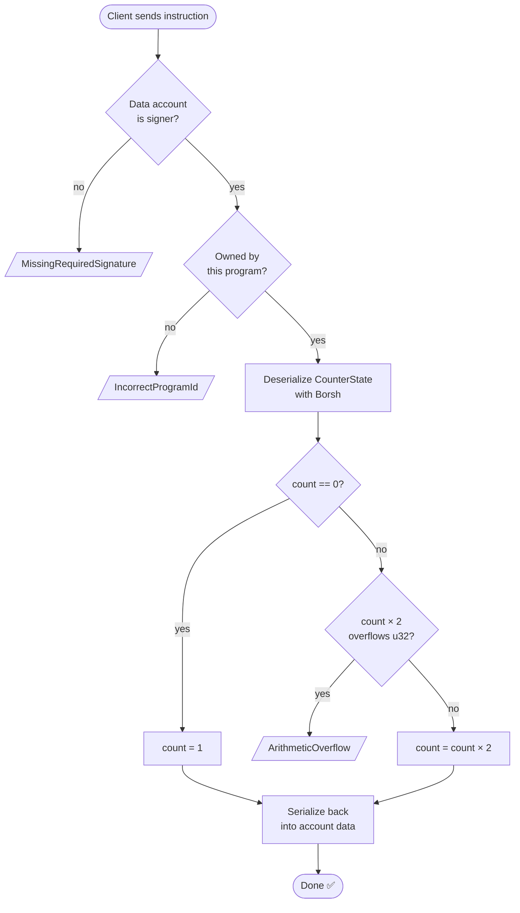

<div align="center">

# ⚡ Solana Doubling Counter

**A tiny native Solana program that starts at `1` and doubles on every call.**

`0 → 1 → 2 → 4 → 8 → 16 → 32 → …`

<br/>


-lightgrey?style=flat-square)


</div>

---

## ✨ What it does

The program owns a small **data account** that stores a single `u32`.
Each time you call it:

| Call # | Stored count before | Stored count after |
| :----: | :-----------------: | :----------------: |
|   1    |         `0`         |        `1`         |
|   2    |         `1`         |        `2`         |
|   3    |         `2`         |        `4`         |
|   4    |         `4`         |        `8`         |
|   n    |        `2ⁿ⁻²`       |       `2ⁿ⁻¹`       |

The new value is written straight back to the blockchain in the same account.

---

## 🔄 How it works



Failed calls leave the stored count **unchanged**.

---

## 🧱 Program interface

**Accounts**

| # | Account      | Signer | Writable | Notes                                   |
| - | ------------ | :----: | :------: | --------------------------------------- |
| 0 | Data account |   ✅   |    ✅    | Owned by the program, exactly **4 bytes** |

**Instruction data:** none (empty).

**State**

```rust
#[derive(BorshSerialize, BorshDeserialize)]
pub struct CounterState {
    pub count: u32,   // little-endian, 4 bytes
}
```

**Errors**

| Error                      | When                                         |
| -------------------------- | -------------------------------------------- |
| `NotEnoughAccountKeys`     | No account was passed                        |
| `MissingRequiredSignature` | Data account did not sign                    |
| `IncorrectProgramId`       | Data account is not owned by the program     |
| `InvalidAccountData`       | Account data is not exactly 4 bytes          |
| `ArithmeticOverflow`       | Doubling would exceed `u32::MAX` (after 32 doublings) |

---

## 🚀 Quick start

### Requirements

- [Rust](https://rustup.rs)
- [Solana CLI tools](https://solana.com/docs/intro/installation) (provides `cargo build-sbf`)
- [Bun](https://bun.sh)

> On Windows, use **WSL (Ubuntu)**.

### Install, build, test

```bash
bun install

cargo test          # 1. Rust unit tests (no validator needed)
cargo build-sbf     # 2. compile to target/deploy/counter_program.so
bun test            # 3. LiteSVM integration tests
```

Or all at once:

```bash
bun run test:all
```

---

## 🧪 Tests

**Rust unit tests** (`src/lib.rs`) call the real `process_instruction` with a mocked account:

- first call sets `1`, then `1, 2, 4, 8, 16, 32`
- missing signature, wrong owner, wrong data size, no accounts
- overflow returns an error and leaves state unchanged

**LiteSVM tests** (`tests/counter.test.ts`) run the compiled `.so` in an in-process SVM:

- fresh counter starts at `0`
- first call → `1`, six calls → `[1, 2, 4, 8, 16, 32]`
- three instructions in one transaction → `4`
- fails without signer / with wrong owner / on overflow
- two counters stay independent

---

## 🛠️ Calling it from a client

```ts
import { Keypair, PublicKey, SystemProgram, Transaction, TransactionInstruction } from "@solana/web3.js";

const dataAccount = Keypair.generate();

// 1. create the 4-byte account owned by the program
const createIx = SystemProgram.createAccount({
  fromPubkey: payer.publicKey,
  newAccountPubkey: dataAccount.publicKey,
  lamports: await connection.getMinimumBalanceForRentExemption(4),
  space: 4,
  programId,
});

// 2. call the program (data account must sign)
const doubleIx = new TransactionInstruction({
  programId,
  keys: [{ pubkey: dataAccount.publicKey, isSigner: true, isWritable: true }],
  data: Buffer.alloc(0),
});

await sendAndConfirmTransaction(connection, new Transaction().add(createIx, doubleIx), [payer, dataAccount]);
```

---

## 🌐 Deploy to devnet

```bash
solana config set --url devnet
solana airdrop 2
solana program deploy target/deploy/counter_program.so
```

---

## 📁 Project structure

```
counter-contract/
├── src/
│   └── lib.rs              # program + Rust unit tests
├── tests/
│   └── counter.test.ts     # LiteSVM tests (bun:test)
├── Cargo.toml
├── package.json
├── tsconfig.json
└── README.md
```

---

<div align="center">

Built with 🦀 Rust and ☕ on Solana

</div>
